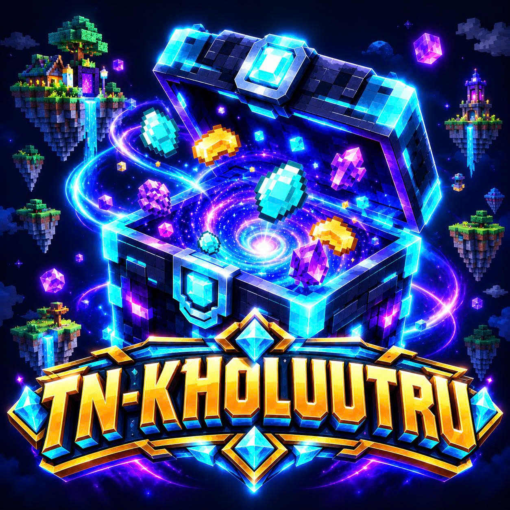

<div align="center">



# 💎 TN-KhoLuuTru

### Kho khoáng sản ảo thông minh cho server Skyblock

*Phát triển bởi* ***Tài Dev Nguyễn***


[📥 Tải xuống](#-cài-đặt) • [🌟 Tính năng](#-tính-năng-nổi-bật) • [🎮 Lệnh](#-danh-sách-lệnh) • [🔐 Quyền](#-hệ-thống-quyền-permissions) • [⚙️ Cấu hình](#️-cấu-hình) • [🎥 Video](#-video-hướng-dẫn)

</div>

---

## 📖 Giới Thiệu

**TN-KhoLuuTru** là plugin "Kho Ảo" dành cho máy chủ Minecraft **Paper / Purpur / Folia 1.21+**. Mọi khoáng sản bạn đào được sẽ **bay thẳng vào kho ảo** thay vì rơi ra đất hay làm đầy túi đồ. Bạn có thể rút, bán, nén thành block, hoặc chia sẻ kho với bạn bè — tất cả qua giao diện GUI trực quan.

Plugin được thiết kế với trọng tâm **chống lạm phát & chống gian lận**, phù hợp cho các server Skyblock có nền kinh tế nghiêm túc.

---

## 🌟 Tính Năng Nổi Bật

### ⛏️ Tự Động Thu Thập (Auto-Pickup)
- Khoáng sản đào được **vào thẳng kho** ngay khi phá block — không rơi ra đất, không đầy túi.
- Tự động **nhặt vật phẩm rơi trên mặt đất** nếu thuộc danh sách cho phép.
- **EXP** từ việc đào được cộng thẳng cho người chơi.
- Tương thích **Fortune, Silk Touch, Autosmelt** và cúp custom từ plugin bên thứ ba (MMOItems, Custom Enchants...).
- Chặn auto-pickup theo **thế giới** (`blocked-worlds`).
- Người chơi có thể **bật/tắt** tự động nhặt cá nhân ngay trong GUI.

### 📦 Kho Lưu Trữ Ảo
- Dung lượng lớn (mặc định **100.000** vật phẩm / người), admin có thể chỉnh riêng cho từng người.
- Giao diện 6 hàng, **phân trang**, **sắp xếp** theo ID / Tên / Số lượng.
- Click vào vật phẩm để: **Lấy 1 • Lấy 1 Stack • Lấy tất cả • Nạp từ túi đồ**.
- Nút **Cất nhanh** — gom toàn bộ khoáng sản hợp lệ trong túi vào kho chỉ với 1 click.
- Dữ liệu lưu bằng **SQLite** hoặc **MySQL** (HikariCP pool), tự động lưu định kỳ.

### 🧱 Nén Khối Nhanh (Quick Craft)
- Nén **9 khoáng sản → 1 block** ngay trong kho, không cần bàn chế tạo.
- Sau khi nén, GUI **tự chuyển sang block vừa tạo**.
- Phân cấp theo rank: giới hạn số block mỗi lần & thời gian hồi chiêu khác nhau.

| Nguyên liệu | ➔ | Kết quả |
|---|:---:|---|
| Coal | ➔ | Coal Block |
| Iron Ingot / Raw Iron | ➔ | Iron Block / Raw Iron Block |
| Gold Ingot / Raw Gold | ➔ | Gold Block / Raw Gold Block |
| Copper Ingot / Raw Copper | ➔ | Copper Block / Raw Copper Block |
| Redstone | ➔ | Redstone Block |
| Lapis Lazuli | ➔ | Lapis Block |
| Diamond | ➔ | Diamond Block |
| Emerald | ➔ | Emerald Block |

### 🤝 Hệ Thống Đối Tác An Toàn (Partner)
- **Mời có xác nhận:** người nhận thấy nút **`[✔ ĐỒNG Ý]`** / **`[✘ TỪ CHỐI]`** bấm được ngay trong chat.
- Lời mời **tự hết hạn** sau thời gian cấu hình (mặc định 60 giây).
- Liên kết **hai chiều** — hủy từ một phía sẽ tự gỡ ở phía còn lại.
- **Giới hạn số đối tác theo rank** (1 / 3 / 5 / không giới hạn).
- **Chống lạm phát & trộm đồ** — mặc định đối tác chỉ được:

| Hành động trong kho đối tác | Mặc định |
|---|:---:|
| Xem kho | ✅ |
| Nạp đồ vào giúp (cày chung) | ✅ |
| Rút đồ ra túi | ❌ |
| Bán đồ lấy tiền | ❌ |
| Nén block nhanh | ❌ |

- Có tùy chọn **cooldown sau khi hủy đối tác** để chặn việc "đổi đối tác liên tục" nhằm tuồn đồ.

### 💰 Bán Vật Phẩm (Vault)
- Bán trực tiếp từ kho: **Click trái** bán 1, **Click phải** bán tất cả, hoặc **Bán toàn bộ kho**.
- Bảng giá tùy chỉnh hoàn toàn trong `config.yml`.

### 📝 Kholist (Danh Sách Trắng)
- Quản lý loại vật phẩm nào được phép tự động vào kho qua GUI hoặc lệnh admin.
- Click đồ trong túi để **thêm**, click đồ trong menu để **xóa** (có bước xác nhận).

### 🧵 Hiệu Năng & Tương Thích
- Hỗ trợ đầy đủ **Folia** (Regionized Multithreading) và **Paper**.
- Truy vấn database bất đồng bộ, cache dữ liệu người chơi, không gây lag main thread.

---

## 📦 Yêu Cầu Hệ Thống

| Thành phần | Yêu cầu |
|---|---|
| **Java** | JDK 21 trở lên |
| **Server** | Paper, Purpur hoặc Folia **1.21+** |
| **Vault** + plugin kinh tế (EssentialsX, CMI...) | *Tùy chọn* — cần cho tính năng bán |
| **PlaceholderAPI** | *Tùy chọn* — cần cho placeholder |

---

## 🚀 Cài Đặt

1. Tải file `KhoLuuTru-1.0.0.jar` mới nhất tại **[Releases](https://github.com/Jaojao00/kholuutru/releases/latest)**.
2. Chép vào thư mục `plugins/` của server.
3. Khởi động lại server.
4. Chỉnh sửa `plugins/KhoLuuTru/config.yml` và `messages.yml` theo ý muốn.
5. Dùng `/kho admin reload` để áp dụng thay đổi.

---

## 🎮 Danh Sách Lệnh

> Lệnh chính: `/kho`

### 👤 Lệnh người chơi

| Lệnh | Chức năng | Quyền |
|---|---|---|
| `/kho` | Mở giao diện kho chính | `kho.use` |
| `/kho help` | Xem hướng dẫn lệnh | `kho.use` |
| `/kho sell` | Mở giao diện bán vật phẩm | `kho.sell` |
| `/kho filter` | Mở giao diện bộ lọc vật phẩm | `kho.filter` |
| `/kho sort <id\|name\|amount>` | Đổi kiểu sắp xếp kho | `kho.use` |
| `/kho view <người chơi>` | Xem kho của đối tác | `kho.partner` |

### 🤝 Lệnh đối tác

| Lệnh | Chức năng | Quyền |
|---|---|---|
| `/kho partner` | Mở GUI quản lý đối tác | `kho.partner` |
| `/kho partner add <tên>` | Gửi lời mời đối tác | `kho.partner` |
| `/kho partner accept <tên>` | Chấp nhận lời mời | `kho.partner` |
| `/kho partner deny <tên>` | Từ chối lời mời | `kho.partner` |
| `/kho partner remove <tên>` | Hủy liên kết đối tác | `kho.partner` |
| `/kho partner list` | Xem danh sách đối tác | `kho.partner` |

### 🛠️ Lệnh quản trị

| Lệnh | Chức năng | Quyền |
|---|---|---|
| `/kho admin reload` | Tải lại cấu hình | `kho.admin` |
| `/kho admin info <người chơi>` | Xem thông tin kho của người chơi | `kho.admin` |
| `/kho admin setcapacity <người chơi> <số>` | Đặt dung lượng kho | `kho.admin` |
| `/kho admin kholist add <material>` | Thêm vật phẩm vào Kholist | `kho.admin` |
| `/kho admin kholist remove <material>` | Xóa vật phẩm khỏi Kholist | `kho.admin` |

---

## 🔐 Hệ Thống Quyền (Permissions)

### Quyền cơ bản

| Quyền | Mô tả | Mặc định |
|---|---|:---:|
| `kho.use` | Sử dụng kho lưu trữ | ✅ Mọi người |
| `kho.autopickup` | Tự động nhặt vật phẩm | ✅ Mọi người |
| `kho.sell` | Bán vật phẩm từ kho | ✅ Mọi người |
| `kho.filter` | Sử dụng bộ lọc | ✅ Mọi người |
| `kho.partner` | Sử dụng hệ thống đối tác | ✅ Mọi người |
| `kho.admin` | Toàn quyền quản trị (bỏ qua giới hạn đối tác) | 🔒 OP |

### 🧱 Cấp Nén Khối Nhanh

| Quyền | Cấp | Tối đa / lần | Hồi chiêu | Mặc định |
|---|---|:---:|:---:|:---:|
| `kho.craft.member` | Member | 64 block | 30 giây | ✅ Mọi người |
| `kho.craft.vip` | VIP | 320 block | 10 giây | ❌ |
| `kho.craft.mvp` | MVP | ♾️ Không giới hạn | Không | 🔒 OP |

*Người chơi có nhiều quyền sẽ dùng cấp có `priority` cao nhất.*

### 🤝 Giới Hạn Đối Tác

| Quyền | Số đối tác tối đa | Mặc định |
|---|:---:|:---:|
| `kho.partner.limit.1` | 1 | ✅ Mọi người |
| `kho.partner.limit.3` | 3 | ❌ (gợi ý: VIP) |
| `kho.partner.limit.5` | 5 | ❌ (gợi ý: MVP) |
| `kho.partner.unlimited` | ♾️ Không giới hạn | 🔒 OP |

<details>
<summary><b>💡 Ví dụ cấp quyền với LuckPerms</b></summary>

```bash
# Rank VIP
lp group vip permission set kho.craft.vip true
lp group vip permission set kho.partner.limit.3 true

# Rank MVP
lp group mvp permission set kho.craft.mvp true
lp group mvp permission set kho.partner.limit.5 true
```
</details>

---

## 🧩 PlaceholderAPI

| Placeholder | Hiển thị |
|---|---|
| `%kholuutru_capacity%` | Dung lượng tối đa của kho |
| `%kholuutru_used%` | Số vật phẩm đã lưu |
| `%kholuutru_free%` | Dung lượng còn trống |
| `%kholuutru_total_items%` | Số loại vật phẩm trong kho |
| `%kholuutru_partners%` | Số lượng đối tác |
| `%kholuutru_autopickup%` | Trạng thái tự động nhặt (Bật/Tắt) |
| `%kholuutru_item_<MATERIAL>%` | Số lượng 1 vật phẩm cụ thể — vd: `%kholuutru_item_DIAMOND%` |

---

## ⚙️ Cấu Hình

<details>
<summary><b>📄 Xem các mục cấu hình chính trong <code>config.yml</code></b></summary>

```yaml
# Lưu trữ dữ liệu
storage:
  type: sqlite              # sqlite hoặc mysql
  default-capacity: 100000  # Dung lượng mặc định mỗi người

# Tự động nhặt
auto-pickup:
  enabled: true
  pick_up_to_storage: true  # Đào xong vào thẳng kho
  whitelist:                # Vật phẩm được phép vào kho
    - DIAMOND
    - EMERALD
    - IRON_INGOT
    # ...
  blocked-worlds: []        # Thế giới không tự động nhặt

# Bán vật phẩm
sell:
  enabled: true
  prices:
    DIAMOND: 100
    EMERALD: 150
    # ...

# Đối tác
partner:
  enabled: true
  default-max-partners: 1
  invite-timeout: 60        # Lời mời hết hạn sau (giây)
  remove-cooldown: 0        # Chờ sau khi hủy đối tác (giây, 0 = tắt)
  permissions:
    allow-withdraw: false   # Đối tác rút đồ
    allow-deposit: true     # Đối tác nạp đồ
    allow-sell: false       # Đối tác bán đồ
    allow-quick-craft: false

# Nén khối nhanh
quick-craft:
  enabled: true
  tiers:
    member: { permission: kho.craft.member, priority: 1, max-blocks-per-craft: 64,  cooldown: 30 }
    vip:    { permission: kho.craft.vip,    priority: 2, max-blocks-per-craft: 320, cooldown: 10 }
    mvp:    { permission: kho.craft.mvp,    priority: 3, max-blocks-per-craft: -1,  cooldown: 0 }

auto-save-interval: 300     # Tự động lưu mỗi (giây)
```
</details>

> 💬 Toàn bộ tin nhắn có thể chỉnh sửa trong `messages.yml` (hỗ trợ mã màu `&`).

---

## 🖥️ Bố Cục Giao Diện

<details>
<summary><b>📦 Kho chính (<code>/kho</code>)</b></summary>

| Ô | Chức năng |
|:---:|---|
| 4 | 📋 Thông tin kho (dung lượng, số loại, trạng thái auto-pickup) |
| 10–43 | Danh sách vật phẩm (click để thao tác) |
| 45 / 53 | ◀ Trang trước / Trang sau ▶ |
| 46 | 🔃 Sắp xếp |
| 47 | 🔍 Bộ lọc |
| 48 | 🤝 Đối tác |
| 49 | ⛏️ Bật/tắt tự động nhặt |
| 50 | 💰 Bán vật phẩm |
| 51 | 📝 Quản lý Kholist |
| 52 | 📥 Cất nhanh từ túi đồ |
</details>

<details>
<summary><b>🎯 Thao tác vật phẩm (click vào 1 vật phẩm)</b></summary>

| Ô | Chức năng |
|:---:|---|
| 10 | Lấy 1 |
| 12 | Lấy 1 Stack (64) |
| 14 | Lấy tất cả |
| 16 | Nạp từ túi đồ |
| 18 | 🧱 **Nén block nhanh** |
| 22 | « Quay lại |
</details>

---

## 📖 Hướng Dẫn Nhanh

1. **Đào khoáng sản** → vật phẩm tự vào kho, không cần làm gì thêm.
2. **Mở kho:** gõ `/kho`.
3. **Rút đồ:** click vào vật phẩm → chọn *Lấy 1 / Lấy Stack / Lấy tất cả*.
4. **Cất đồ nhanh:** bấm nút 📥 **Cất nhanh** (ô 52).
5. **Nén block:** click vào khoáng sản (vd: Diamond) → bấm ô **18** → kho tự chuyển sang Diamond Block.
6. **Bán đồ:** bấm 💰 (ô 50) → click trái bán 1, click phải bán hết.
7. **Mời bạn cày chung:** `/kho partner add <tên>` → bạn bấm **[✔ ĐỒNG Ý]** trong chat.

---

## 🎥 Video Hướng Dẫn

<div align="center">

[](https://youtu.be/yqa4h8YieXo?si=gkySdvsoM9UtMXXE)

*Nhấn vào ảnh để xem video giới thiệu & hướng dẫn chi tiết*

</div>

---

## ❓ Câu Hỏi Thường Gặp

<details>
<summary><b>Vật phẩm đào không vào kho?</b></summary>

- Kiểm tra vật phẩm có trong `auto-pickup.whitelist` / Kholist không (dùng **tên vật phẩm sau khi rơi**, vd: `DIAMOND` chứ không phải `DIAMOND_ORE`).
- Kiểm tra người chơi đã **bật auto-pickup** (ô 49 trong GUI) và có quyền `kho.autopickup`.
- Kiểm tra thế giới hiện tại không nằm trong `blocked-worlds`.
- Kiểm tra kho chưa đầy dung lượng.
</details>

<details>
<summary><b>Đối tác có lấy trộm đồ của tôi được không?</b></summary>

Không. Mặc định đối tác chỉ được **xem** và **nạp thêm** đồ. Rút, bán, nén block đều bị chặn (`partner.permissions` trong config).
</details>

<details>
<summary><b>Có hỗ trợ MySQL cho nhiều server không?</b></summary>

Có. Đặt `storage.type: mysql` và điền thông tin kết nối trong `storage.mysql`.
</details>

---

## 🔒 Bảo Mật & Bản Quyền

- Đây là plugin **mã nguồn đóng** — repository này chỉ chứa tài liệu và bản phát hành.
- Vui lòng **không** dịch ngược, chỉnh sửa hoặc phân phối lại khi chưa có sự cho phép của tác giả.
- Báo cáo lỗ hổng bảo mật: xem [SECURITY.md](SECURITY.md).

---

## 👨‍💻 Tác Giả

<div align="center">

**TN-KhoLuuTru** được thiết kế và phát triển bởi **Tài Dev Nguyễn**

📧 [tainguyenhr.dev@gmail.com](mailto:tainguyenhr.dev@gmail.com)

Góp ý hoặc báo lỗi? Liên hệ qua email hoặc tạo một [Issue](https://github.com/Jaojao00/kholuutru/issues).

⭐ *Nếu thấy plugin hữu ích, hãy để lại một Star cho repository nhé!* ⭐

</div>
